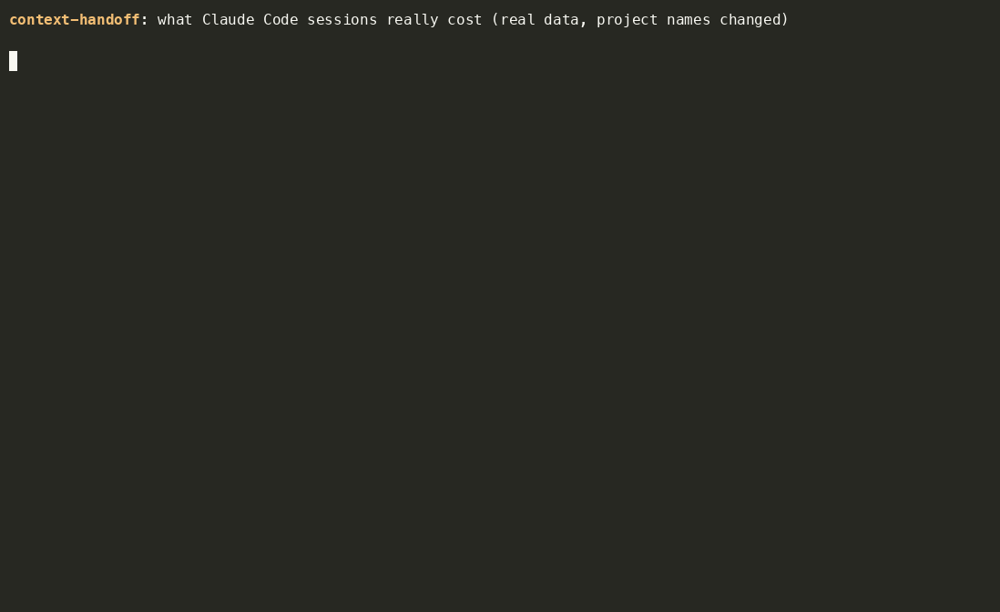

# context-handoff

[](https://github.com/YauhenBichel/context-handoff/actions/workflows/ci.yml)
[](https://github.com/YauhenBichel/context-handoff/releases)
[](LICENSE)

A Claude Code plugin that keeps long sessions from getting expensive: it shows
what each turn costs, writes a handoff note when the session grows, and resumes
from it after `/clear`.

```
/plugin marketplace add YauhenBichel/context-handoff
/plugin install context-handoff@context-handoff
```

Python 3.10+ as `python3`, nothing else. Details in [Install](#install).



*Real sessions, project names changed: about $1,070 in 14 days at API list
prices, 24 of 34 sessions past 150K context, and one session, open for weeks,
past the 400K block limit.*

Every Claude Code turn re-sends the whole conversation. While the prompt cache
is warm that re-read is cheap; after a pause the whole context is written to
the cache again at up to 2× the input price. A 400K-token session on Claude
Opus 5.5 pays about $3.20 for one such cold turn, before Claude writes a word.
Long sessions also get slower and lose focus.

context-handoff watches what each turn costs. When a session gets too big or
too expensive, Claude writes a short handoff note at the end of the current
task. You run `/clear`, type `go`, and a fresh, small session continues from
the note.

What you see above a prompt once a session is past the warn limit:

```
[context-handoff] 182K context, last turn $0.61, session $14.20, a cold turn would cost $1.46
(claude-opus-5-5 prices). Claude will write a handoff note after this task; then /clear and type go.
```

## How it works

1. **Meter** (`UserPromptSubmit` hook). Before each prompt it reads the
   session transcript and computes, at API list prices:
   - the context the next turn will re-send,
   - what the last turn cost,
   - what the whole session cost,
   - what one cold turn would cost now.
2. **Auto handoff**. Over a warn limit, it asks Claude (once per session) to
   write a handoff note when the current task is done.
3. **Block**. Over a block limit, it holds the prompt until you type `handoff`
   or add `#override`.
4. **Resume** (`SessionStart` hook, after `/clear`). It loads the project's
   newest unused note into the new session, so you type `go` instead of
   pasting a prompt. Each note is loaded once.

## Install

In Claude Code:

```
/plugin marketplace add YauhenBichel/context-handoff
/plugin install context-handoff@context-handoff
```

Or from a terminal:

```
claude plugin marketplace add YauhenBichel/context-handoff
claude plugin install context-handoff@context-handoff
```

Restart Claude Code (or start a new session) to load the hooks. The meter
line appears from the second prompt of a session.

Requires Python 3.10 or newer on `PATH` as `python3`. No other dependencies.

### Without Claude Code plugins

The same code is on PyPI. It gives the `context-handoff` command for reports
and checks, for example in a shell or on a machine where you don't use the
plugin:

```
pipx install context-handoff        # or: uv tool install context-handoff
context-handoff report 14
```

The hooks still come from the plugin above; the package does not install them.

Update or remove:

```
claude plugin marketplace update context-handoff
claude plugin update context-handoff@context-handoff
claude plugin uninstall context-handoff@context-handoff
```

## Use

- **Normal flow**: keep working. When the meter asks, Claude writes the note
  after the current task and tells you. Run `/clear`, then type `go`.
- **By hand**: `/context-handoff:handoff`, then `/clear` and `go`.
- **Past a block**: start the prompt with `handoff`, or add `#override`.
- **Check a session**: `python3 bin/context-handoff check <transcript.jsonl>`.
- **Report** of the last N days (default 7):
  `python3 bin/context-handoff report 14`.

## Settings

Defaults, then `~/.claude/context-handoff.json`, then environment variables
(`CONTEXT_HANDOFF_` + the key in upper case). A limit of 0 turns it off.

| Key | Default | Meaning |
|---|---|---|
| `warn_k` | 150 | context size (thousands of tokens) that triggers a handoff |
| `block_k` | 400 | context size that blocks prompts |
| `warn_turn_usd` | 0.50 | cost of the last turn that triggers a handoff |
| `block_turn_usd` | 3.00 | cost of the last turn that blocks prompts |
| `warn_session_usd` | 20 | session total that triggers a handoff |
| `auto_handoff` | true | Claude writes the note itself; false = only a warning |
| `max_age_min` | 180 | notes older than this are not resumed |
| `handoff_dir` | `~/.claude/handoffs` | where notes go |
| `state_dir` | `~/.claude/context-handoff` | log (`meter.jsonl`) and per-session markers |
| `prices` | see [prices.py](src/context_handoff/prices.py) | `{"model-prefix": [input, output, cache_read]}` per million tokens |

Example `~/.claude/context-handoff.json`:

```json
{ "warn_turn_usd": 1.0, "warn_session_usd": 50, "prices": { "claude-opus-5-5": [4.0, 20.0, 0.20] } }
```

## Prices

The default table holds Anthropic's first-party API list prices as of November
2026. Cache writes are priced at 1.25× input (5-minute TTL) or 2× input (1-hour
TTL). On a Claude subscription you do not pay per token, but the same numbers
show how fast a session uses your limits. Prices change: override them in the
config file.

## Hands-free: auto-compact

A plugin cannot run `/clear`, and Claude Code (2.1.263) does not start a
cleared session by itself, so the `/clear` flow needs you to type `go`.
Automatic compaction is different: when it fires, the session continues by
itself. context-handoff hooks into it:

- **`PreCompact`**: the compaction summary is written with the handoff note's
  sections (goal, state, decisions, open items and next steps, where things
  are, gotchas).
- **`SessionStart` after a compaction**: the newest unused handoff note, if
  Claude wrote one, is added next to the summary. It stays unused, so a later
  `/clear` still loads it.

Claude Code compacts only near the full context window. To compact at the
warn limit instead, set the window in `~/.claude/settings.json`:

```json
{ "autoCompactWindow": 150000 }
```

or `export CLAUDE_CODE_AUTO_COMPACT_WINDOW=150000`. A compaction summary is
lossier than a note Claude writes on purpose, so `/clear` with a note is still
the cheaper, sharper way when you are at the keyboard.

## Limits

- A plugin cannot run `/clear` for you. That one step stays manual; use
  [auto-compact](#hands-free-auto-compact) to continue without typing.
- Notes are matched by the project folder's name, and only those newer than
  `max_age_min` are loaded.
- The meter reads the transcript, so the first prompt of a session is not
  metered.
- Costs are estimates from the transcript's usage fields, not your bill.

## Privacy

Everything runs locally. The plugin reads your transcripts in `~/.claude` and
writes notes and a log there. Nothing is sent anywhere. Do not put secrets in
handoff notes.

## FAQ

### How do I reduce Claude Code costs?

Keep sessions small. Most of the cost of a long session is re-reading its own
context: every turn re-sends the whole conversation. Finish a task, write a
handoff note, run `/clear`, and continue in a fresh session. context-handoff
tells you when to do it and writes the note for you. Run
`context-handoff report 14` to see where your own cost goes.

### Why does Claude Code get expensive after a pause?

The prompt cache expires. Claude Code caches the conversation for one hour;
after a longer pause the next turn writes the whole context into the cache
again at 2× the input price. On a 400K-token session that is about $3.20 for
one turn on Claude Opus 5.5. The meter shows this "cold turn" cost before each
prompt.

### How do I continue a Claude Code session after `/clear`?

Ask Claude for a handoff note before `/clear` (`/context-handoff:handoff`, or
let the plugin ask automatically). After `/clear`, the `SessionStart` hook
loads the project's newest unused note, so you type `go` and the new session
continues from it.

### How big should a Claude Code session get?

The defaults warn at 150K tokens of context, $0.50 for one turn or $20 for a
session, and block at 400K or $3 for one turn. Change them in
`~/.claude/context-handoff.json`; see [Settings](#settings).

### Does it work in VS Code and the desktop app?

Yes. Installed at user scope, the plugin's hooks run in every Claude Code
client that reads `~/.claude`: the terminal, the VS Code extension and the
desktop app.

### Does it work on a Claude subscription?

Yes. You don't pay per token, but the numbers show how fast a session uses
your plan's limits, and smaller sessions stretch them.

### Does it send my code or transcripts anywhere?

No. It reads local transcripts and writes local notes. See [Privacy](#privacy).

## Development

```
python3 -m unittest discover -s tests
```

See [CONTRIBUTING.md](CONTRIBUTING.md).

## License

MIT, see [LICENSE](LICENSE).
